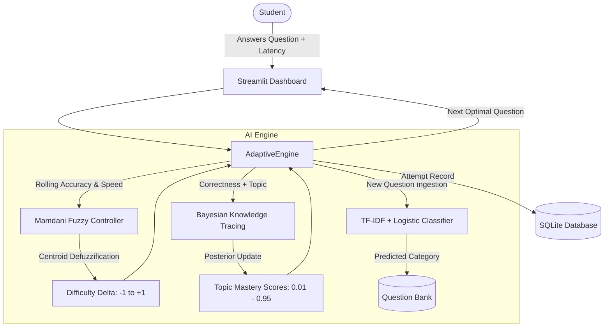
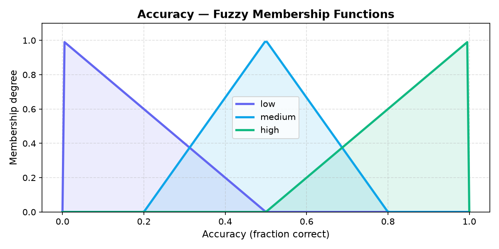
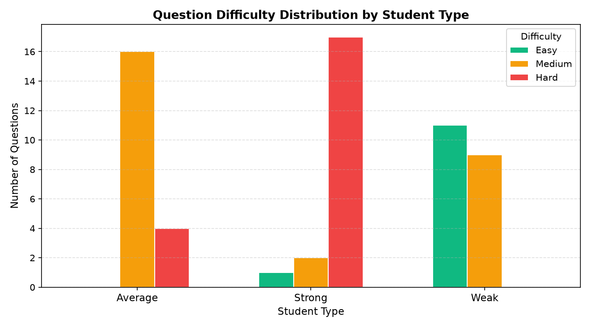

# AdaptIQ — Adaptive AI Learning System

**AdaptIQ** is an intelligent, real-time adaptive learning engine designed to assess student competency, dynamically modulate assessment difficulty, and model latent knowledge states. Built with a combination of **Mamdani Fuzzy Logic**, **Bayesian Knowledge Tracing (BKT)**, and **Natural Language Processing (NLP)**, AdaptIQ delivers individualized pedagogical pacing and cognitive telemetry.

---

## Key Highlights

- **Mamdani Fuzzy Pacing Engine**: 9 inference rules computing real-time difficulty adjustments from rolling response accuracy and response latency.
- **Bayesian Knowledge Tracing (BKT)**: Probabilistic student mastery modeling with slip, guess, and transition parameters, enforced with **Cromwell's Rule** ($0.01 \le P(L_t) \le 0.95$) to prevent certainty traps.
- **NLP Topic Classifier**: Automated question bank classification using TF-IDF n-grams (1, 2) and Logistic Regression.
- **Targeted Remedial Practice**: 1-click single-topic drill generation targeting lowest-mastery subjects.
- **Cognitive Behaviour Telemetry**: 4-quadrant pacing matrix (*Rapid Fluency*, *Deep Mastery*, *Hesitant Competence*, *Critical Struggle*) and responsive vector SVG radar visualizations.

---

## System Architecture



---

## Mathematical Formulations

### 1. Bayesian Knowledge Tracing (BKT)

When a student answers a question for a topic, the latent mastery probability $P(L_t)$ updates based on correctness:

$$\text{If Correct: } P(L_t \mid \text{Correct}) = \frac{P(L_{t-1}) \cdot (1 - P(S))}{P(L_{t-1}) \cdot (1 - P(S)) + (1 - P(L_{t-1})) \cdot P(G)}$$

$$\text{If Incorrect: } P(L_t \mid \text{Incorrect}) = \frac{P(L_{t-1}) \cdot P(S)}{P(L_{t-1}) \cdot P(S) + (1 - P(L_{t-1})) \cdot (1 - P(G))}$$

Following observation, knowledge transition occurs:

$$P(L_t) = P(L_t \mid \text{Evidence}) + (1 - P(L_t \mid \text{Evidence})) \cdot P(T)$$

**Standard Parameters:**
- $P(L_0) = 0.50$ (Prior Mastery)
- $P(T) = 0.15$ (Transit Probability)
- $P(G) = 0.20$ (Guess Probability)
- $P(S) = 0.10$ (Slip Probability)
- Bound: $P(L_t) \in [0.01, 0.95]$ (Cromwell's Rule applied to guarantee responsiveness to subsequent errors).

### 2. Mamdani Fuzzy Inference

- **Inputs**:
  - `Accuracy`: Rolling window [0% – 100%]
  - `Speed`: Average response latency [5s – 60s]
- **Outputs**:
  - `Difficulty Adjustment`: [-1.0 (Decrease) to +1.0 (Increase)]
- **Defuzzification**: Centroid technique over 9 rule activations.

---

## Repository Structure

```
AdaptIQ/
├── app/
│   └── app.py                     # Streamlit frontend & interactive telemetry UI
├── data/
│   ├── app.db                     # Local SQLite database (seeded on first run)
│   └── questions.csv              # Curated Python assessment question bank
├── docs/
│   ├── confusion_matrix.png       # NLP topic classifier evaluation matrix
│   ├── membership_accuracy.png    # Fuzzy membership curve (Accuracy)
│   ├── membership_level.png       # Fuzzy membership curve (Difficulty)
│   ├── membership_speed.png       # Fuzzy membership curve (Latency)
│   └── simulation.png             # Multi-student adaptive simulation trajectory
├── models/
│   └── topic_classifier.joblib    # Pre-trained TF-IDF Logistic Regression pipeline
├── scripts/
│   ├── plot_membership.py         # Script generating fuzzy membership curve visualizations
│   ├── simulate_students.py       # Simulation runner across synthetic student personas
│   └── train_classifier.py        # NLP model training & serialization script
├── src/
│   └── adaptive_engine/
│       ├── __init__.py
│       ├── classifier.py          # TF-IDF + Logistic Regression module
│       ├── db.py                  # SQLite storage & attempt logging schema
│       ├── engine.py              # Adaptive orchestration core
│       ├── fuzzy.py               # Scikit-fuzzy Mamdani rule definitions
│       └── mastery.py             # Bayesian Knowledge Tracing state manager
├── tests/
│   ├── __init__.py
│   └── test_system.py             # 11 unit test assertions (Fuzzy, BKT, SQLite, NLP)
├── .gitignore
├── LICENSE
├── pyproject.toml
└── requirements.txt
```

---

## Quickstart Guide

### 1. Clone the Repository

```bash
git clone https://github.com/Akshayp8/AdaptIQ.git
cd AdaptIQ
```

### 2. Create and Activate Virtual Environment

```bash
# Windows (PowerShell)
python -m venv .venv
.venv\Scripts\Activate.ps1

# Linux / macOS
python3 -m venv .venv
source .venv/bin/activate
```

### 3. Install Dependencies

```bash
pip install -r requirements.txt
```

### 4. Initialize Database

```bash
python scripts/seed_db.py
```

### 5. Launch the Application

```bash
streamlit run app/app.py
```

Open your browser to `http://localhost:8501`.

---

## Running the Test Suite

Execute comprehensive unit tests covering Fuzzy Logic boundaries, Bayesian transitions, Cromwell bounds, database persistence, and NLP classification:

```bash
pytest -v
```

---

## Cognitive Visualizations

| Fuzzy Membership Curves | Adaptive Simulation Trajectory |
| :---: | :---: |
|  |  |

---

## License

This project is licensed under the [MIT License](LICENSE).
